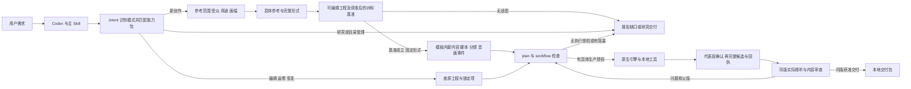

# 制作流程

从输入到制作、审阅、返修及运营交接，沿 [整体视频制作工作流](制作配方/视频制作工作流.md) 消费跨任务复盘结果；`content-plan` 返回全文与哈希。知识歌曲再消费 [专项配方](制作配方/知识歌曲首版.md)。内容阶段冻结实际消费材料，代表段先检验因果/音乐/连续性及审片入口，再扩整片；工具可换，阶段输入输出不换。认可基准及外部AI审阅边界见配方，不把规则读取当作成片质量验证。

## 视觉素材与设计方向（2026-11-17）

已接入的真实组件先用 `studio.py --mode research|development visual-build` 渲染关键画面或动效素材，输出 PNG、WebM/MP4、源码 ZIP 与 `studio-inputs.json`；`visual-compose` 可将包装与本地图片/视频背景合成，再按现有 brief 的图片/视频/原生素材输入引用并核哈希。Overlay 20项均完成图片、换参、5秒动效、背景合成和输入检查，19项透明叠加，FocusCard为不透明场景；逐项证据见 [实测页面](research/2026-11-17-视觉素材与审美/verification/all20/index.html)。具体用法和许可见 [素材工作台说明](../resources/visual-library/README.md)。这些是技术与抽样画面验证，不创建作品、不增加模板资格、不放行成片质量。系列风格、因果动作、声画锚点、同物件跨镜头的做法沿视觉设计方法正文消费。

图片、封面及视频先按本题受众和承诺定视觉概念，沿 [视觉设计 Skill](../.agents/skills/studio-visual-design/SKILL.md) 用 `studio.py visual-assets` 检索真实字体、纹理、图形、声音及 Atlas/Motion Prompt 的效果定义、提示词和运动参数；`content-plan` 已返回同一份方法与素材上下文。预览在 [视觉材料工作台](../resources/visual-library/index.html)。先定构图/层级/材质和关键画面，再交既有生成或可编辑动效引擎；参考图分别注明身份、构图、风格或事实证据用途，Atlas示例图不因收录而获得复用许可。

既有模板升级保留全文、有效动作与父版，用具体资产改善信息和质感。用户需要模板外方向时可先研究、设计与验证代表画面；这不是已有模板资格，当前 make 的绑定与 stage_handoff 检查保留。缺引擎适配须明确，不能硬套近似模板、伪填 ID 或用独立脚本绕过审阅。四份起步配方及本地素材可读不证明新图/新片效果；研究与证据边界见 [本轮采用报告](research/2026-11-17-视觉素材与审美/研究与采用.md)。

2026-11-15 当前执行以[内容改编与整改后的入口](内容改编与整改后的入口.md)为准：全文/事件/镜头消费、资格分层、局部依赖、真实观察与包装状态均已接入原入口；技术验证不能代替内容能力验证。市场资格 0、生产资格 0，历史数字不作为当前资格。

**2026-11-15严重失败整改：** [开箱刀完整复盘](reviews/2026-11-15-开箱刀严重失败复盘与项目整改.md)已核原用户参考、实际工程消费及承诺差异。当前19个入口仅为工程储备；近期市场资格0、生产资格0。正式推荐需近三年原帖证据与实际复用方法记录共同成立；试验阶段不得直接扩自媒体整片。完整审阅须同版、正常速度、无未感知区间，采样/分段音轨/ended不替代；程序只核绑定与声明，不证明审美或诚实。本轮不恢复开箱刀生产。

**观众目标先于工程：为什么停下 → 为什么继续 → 最后得到什么。** 选题、模板能力核验、代表段和同版审片统一应用[观众视角与制作避坑](观众视角与制作避坑.md)，复用现有创作合同与审查记录。下面的市场/结构/导出检查不能证明观看价值；`night-garden-1114/v0003`已被用户1/10否决，旧放行撤回。

**当前入口：具体参考/指定形式→核工程与对标基准→固定模板→模板内换内容与脚本→获准换稿验证→同版视听→持续复用。** 以[收窄后的项目路线](内容改编与整改后的入口.md)为准，一个形式成立再扩下一种；本轮只维护项目。 [统一目录](视频风格模板目录.md)与[机器目录](../templates/catalog.json)登记13观看家族、18工程分支＋1专业乐谱、25历史归档；44研究配方不计完整模板。市场与新稿质量资格以机器目录及对应任务的[STATUS](../STATUS.md)为准，不能由技术检查补齐。授权按当前聊天与任务核定；2026-11-15本轮进一步落实阶段交接程序、Prompt和Skills，不新制、不重跑旧片。

| 步骤 | 实际输入 → 输出 | 执行与检查 |
|---|---|---|
| 1. 意图与阶段 | 用户原话、上下文、素材、旧任务 → 新创作/研究/返修/恢复/目录管理 | `intent`给模式、能力包和候选；Codex保留“下一轮再做”“不制作”等限制，匹配不授予生产权限 |
| 2. 参考与基准 | 已有用户链接/指定形式 → 完整表达机制、可编辑工程及缺口 | 先核具体成片，不把教程或10秒风格演示算完整模板；获准后制作对标基准，已有有效基准复用 |
| 3. 固定形式 | 确切参考及基准 → 一个父工程、固定项与可变边界 | `templates match`提供有限候选和缺口；Codex核实际源工程，不以相似外壳兜底。参考研究、工程储备、市场及换稿质量资格分别判断 |
| 4. 模板内内容开发 | 模板 + 新主题/完整稿 → 有新事实/情绪回报的脚本、因果分镜及音画事件 | `content-plan`消费原反馈与内容方法；逐段检查保留和替换能否成立，超出动作、画幅或声音能力先报具体缺口，不暗改形式 |
| 5. 工程交接 | 模板绑定与冻结输入 → brief / plan / workflow | 新代码`make`写作品前核绑定、方向、画幅和引擎；`workflow create`同检。`prepare`按目录登记的纸墨、事件、照片和Opuscar原生入口准备；归档模板拒绝新建，旧版恢复/返修沿父合同 |
| 6. 代表段 | 开头3秒、最难因果段、关键声音事件 → 可看候选 | 新方向先给用户看，确认后再扩整片；已确认方向的局部返修复用。方法与记录沿下节，不是自动审美拦截 |
| 7. 整片与音画 | 一份事件时间线 → MP4、字幕与实际音轨 | 可无声；有声时用实际音频/动作事件定位字幕、音效与音乐，不按字数平均摊。小物/纸艺在真实输入检查绑定故事、场景、字幕、WAV和接触采样；结构合同不等于听感通过 |
| 8. 同版修复与交付 | 确切候选 → 自动全片2fps抽帧 → 实际观察与完整看听 → review-save → export/离线包装 | 审查包绑定视频/回执、每帧/证据SHA和需求；缺审、过期、待审、未解决问题在真实导出/新包装入口阻止。程序只验绑定覆盖和记录结论，不能认证审美、真实听感或人审；失败保留，可诊断预览 |
| 9. 旁路成片收编 | 已有 Vibe 成片、锁定音轨、字幕、原要求 → 隔离登记根里的版本 | `adopt-vibe` 只读复制并探测真实媒体，登记根不得位于或包含仓库 `works/`；锁定音轨由统一 `check_delivery` 核哈希。登记后走第 8 步；唱词与画面是否同步、内嵌音轨是否等于锁定音轨都未验，登记不是放行 |

## 代表段先确认方向

开工先对照[观众视角与制作避坑](观众视角与制作避坑.md)及[剩余方案的失败清单](plans/2026-11-16-剩余任务与制作流程方案.md#2-已发生的失败与对应拦截点)，把与本片相关的反例对应到现有阶段、真实检查或待验；程序检查与内容判断分开记录。已有有效研究、工程、音轨和反馈直接消费。

方向尚未被用户确认时，先制作包含开头 3 秒和最难因果段的代表段，用冻结音轨的对应片段，长度按内容确定；不以最容易的短段代替难点。若两部分不连续，标明各自原片时间范围。先做技术核对和真实观察，明确待审范围后作为诊断预览给用户看，收到方向确认再扩全片；保留否决与父版，按具体问题返修代表段。

代表段路径/哈希、实际时间范围、音轨哈希及用户真实反馈放原作品状态，并作为原 workflow 对应画面阶段的 `artifacts` 消费；`confirm-stage` 只冻结结构，不能冒充用户已确认。方向已确认的局部返修继续沿原合同，仅重开变化依赖。此处是 Codex 执行要求，当前没有自动读取聊天并阻止全片渲染的程序。

一次对话可以完成需求整理、工程适配、代表段检查、整片制作、审查及获准的本地交付；这些是同一任务的内部阶段，不要求用户另开聊天、填写 JSON 或运行命令。已确认方向的返修不重复索要方向确认。实际缺少音源授权、关键业务选择或真实视听能力时，明确具体缺口；程序和自评分都不能保证一次生成即达到高分。

《还没落地》返修暴露的具体检查沿现有画面阶段执行：开头落球等首次动作完成后，检查下一乐句是否还有可见的新动作或信息，小幅表情变化不自动算节奏推进；测量线两端必须落在实际对象边缘；相机拉近／拉远须检查整条运动路径和转场，不能只挑七个关键时刻；解释向量保持可读尺度，避免随镜头放大遮住主体；接物动作检查接触前、接触及收回后的手物关系；后半复现主题时须新增行动或因果结果，不能只重复图解。实际反例和修法保留在[本片记录](../works/falling-studio-1116/内容承载与返修.md)。这些内容判断由 Codex 实际观察，不是自动几何或审美检查。

## 审查只留三份主记录

沿现有 `review-prepare → review-save → review-status → export`，主记录为审查包 `frames.json`、交叉核对表 `cross-check.md`、最新同版结论 `rNNNN.json`。`draft.json` 为工作稿，旧 r 修订保留；外部模型报告、逐秒图、完整音轨观察证据、播放遥测和一次性脚本均作为附件引用，不另立放行报告。目录、逐条核对字段及证据绑定统一按[审查与版本](../.agents/skills/self-media-studio/references/审查与版本.md#一次审查的三份主记录)。

新审查包自动生成带版本/哈希的核对表草稿，恢复不覆盖。外部结论每条核实后标采信、丢弃或待核对；采信问题进入正式 `issue/open finding`，未核实保持 `pending`。保存前把表与观察附件的 SHA256 绑定到相关检查。助手观察不参与放行；盲听争议与能力限制照实保留。核对表不自动审片，技术成功、模型分数或三份文件齐全均不证明成片合格。

## 阶段之间交什么，何时回退

2026-11-15从[七条参考与固定源码](research/2026-11-15-原片源码与工作室复盘/研究总览.md)落实。下表描述业务交接；新增实际字段/文件/依赖冻结保存在原workflow task，并由plan、make、代码返修及resume消费。操作和准确覆盖范围见[阶段交接与局部返修](阶段交接与局部返修.md)。这仍不是自动导演或质量判断程序。

| 交接 | 下一环节直接消费 | 变化时只重开 |
|---|---|---|
| 需求/资料→选型 | 用户原话与保留项、事实来源/条件、现有任务/素材身份、授权阶段 | 被纠正的要求及其依赖；研究请求停在研究交付 |
| 构思/粗镜头→工程适配与具体分镜 | 模板来源/文件/调用处、已观察完整表现、可替换处、缺失能力 | 真实不适配部分；不重复扩搜已有效方案 |
| 脚本→音画编排 | 事实因果、事件ID、角色/道具首末状态、相邻镜承接 | 改变的事件及下游；不让每镜重新导演整片 |
| 声音→精确定时 | 最终音源哈希、口播语句/歌词乐句/对白或物理动作锚点；发音稿与显示稿 | 换音轨使旧锚点失效；只改显示文字不默认重配音 |
| 编排→获准制作/编辑 | 同版素材路径/ID、输入与源码哈希、真实原任务回执、锁定轨/手工修改 | 先查原结果，未知不重交；确定性步骤批量执行 |
| 候选→审查/局部返修 | 确切全片、完整音轨、父版、源时间→成片时间映射 | 最早变化的依赖与相邻衔接；同类失败先诊断，不循环评分 |
| 同版交付→包装/运营 | 审过的版本/哈希、可编辑范围、来源许可、具体未验项 | 包装改变只复核包装；发布按授权，实际数据回到下次选题 |

知识说唱采用“事实→歌词乐句→最终声音→因果镜头”，角色教育采用“重复语言→反应升级→行动兑现”，生活叙事保留可见小动作及情绪回收。这些是不同编排方法，不能统一降成字幕卡片。OpenFilm尚未安装/接入，只吸收时间、轨道、保护修改的思想；Fred组件调用链的方法已进入P1/P4，AST门禁未移植。

沿既有作品状态、输入哈希、原生工程和候选主链，不建平行状态机。模板结构检查不判断吸引力、自然表演或九分效果。其他独立原生CLI不受新增`make`绑定检查覆盖，Codex仍须遵循此流程。已有素材编辑、恢复、续做与局部返修沿父工程和锁定项，不重新选风格。

工作室从本机 Codex 的[主 Skill](../.agents/skills/self-media-studio/SKILL.md)进入，项目配置为 `gpt-6.1-sol`。Codex 决定内容、镜头和工具，`studio.py` 检查交接单、约束和状态。原生引擎执行本地操作并拥有各自的可编辑格式。CC Switch / One API 的 [Opus 5.5 可选制作路线](design/04-Codex与可选制作模型.md)仍是草案。

原[P1–P6](research/2026-11-13-后续制作方法与Prompt.md)与[六维D1–D6](research/2026-11-13-六维方法与Prompt.md)继续提供工程、事件链、镜头、表演、字幕、声音和封面方法；P1工程选择现在发生在模板选定后。资料和旧版走查是历史依据，不是制作授权。只借渲染外壳重写卡片动画不算工程复用。前阶段四条新片与改画保音记录属于历史交付证据；本轮七条外部参考已完成获准方式的全时段画面和完整音轨模型分析；本项目新成片的真人听审与质量验证不能据此升级，也不能因为方法写入就称效果提升。



| 用户目的 | 模式与入口 | 停止点 |
|---|---|---|
| 只看一个方向、参考或表达方式 | `research workflow` | 观察、假设、原创约束，停在研究交付 |
| 只有主题、完整稿、参考、图片或录屏，先确认方案 | `design workflow` 或 `plan`；`development` 用于框架核查 | 选题/脚本/分镜中本次约定的产物，保留来源和锁定项 |
| 接手旧 ZIP、判断未知任务或回退 | `recovery workflow`；`status`、`inspect-bundle`、`import-native`、`select-version` | 原生树、现有状态或指定活动版；外部状态未知时查原任务回执 |
| 明确要求生产或局部返修 | `production workflow` 检查，按实际授权调用具体引擎入口 | 缺依赖回到计划；成功以候选的同版审查继续 |
| 复制已存在版本 | `delivery workflow`、`export --version` | 本地交付 |
| 已有成片准备标题、封面、标签与离线发布包 | `delivery workflow` 的 `action=publish`；`publish-check/pack/verify` | 同版原视频与独立p修订、可预览ZIP；不接账号、不上传、不发布 |
| 导入真实数据、复盘已有发布包 | `workflow` 的 `action=analytics`；只读 `content-analyze`、`delivery content-review` | 本地a修订；无数据保持待数据，不自动制作下一条 |

先运行 `python3 scripts/studio.py intent '<用户原话>'`，读取 `profile`、`candidate_profiles`、`suggested_mode`、`packs`、`routes`。Codex 结合前文确认本次意图，必要时用 `--profile` 补充。同一句话里说了“先搭框架”或“只研究”时，保留这个范围；没有命中就回到目标和已有输入。每个能力包给出项目 Skill、按需阅读的路径和缺件，每条路线给出原生入口、依赖和适用限制。多个候选时在镜头或工作项层面选择，留存各自的原生格式。

不带修改选项的 `workflow` 只读；`--confirm-stage` / `--reopen-stage` 显式保存阶段记录，`--stage ID` 返回最小阶段上下文。`next` 指后续操作，`blockers` 给出阻塞，`stop_at` 给出本次交接边界。恢复、生产、交付的写入命令仍需各自显式模式。

`plan` 和 Workflow 的计划交接共用 brief 与输入检查。输入已声明 `sha256` 时，必须匹配实际字节；导入也先核对，不能把变更后的素材静默重设为原哈希。新素材可在首次导入时建立哈希，修改已冻结素材需使用新素材 ID。代码路线同时检查旁白/字幕合同及媒体起点；新建或未提交候选的 `build` 在建立版本、pending 和运行媒体工具前重核输入。已经提交的候选确认沿用回执与 brief 核验，不因原导入位置变化而重制。

编辑路线的 `plan` 还通过 `adapters/native-editor.mjs --plan` 读取素材的 FFprobe 元数据，调用固定原生 `applyOperations/validateTimeline`，返回 `editor_timeline` 的帧数、输出和轨道数量。不支持的操作、源时间越界、无效画幅或不存在的音轨会被拒绝；没有准备素材、配音、读旧 Provider 配置或渲染。`make` 在创建作品前核查，整份编辑操作返修、重建和继续未提交候选在 `build` 创建版本前重核；已提交候选的确认保留原有回执核验，锁轨补丁走自己的原生校验。该计划只证明源元数据与时间线合同相容；转码、实际解码和视听效果仍须在授权制作后核验。

在项目根目录运行 `python3 scripts/studio.py --mode design workflow task.json` 可核对下面的交接单。

```json
{
  "action": "plan",
  "request": "用这段录屏解释关键操作，保留实际按钮和原声。",
  "project": "focus",
  "route": "editor",
  "locks": ["录屏关键操作和原声"],
  "brief": "examples/briefs/focus.json"
}
```

路径可相对交接单，也可用绝对路径。`restore` 填 `project/bundle`，`revise` 填 `project/version/edit_kind/patch/locks`，`review` 填 `project/version/review`，`export` 填 `project/version`。未知外部任务用 `external_task: {id, provider}` 保留原任务身份，返回 `check_original_receipt`。

发布与复盘交接分别填 `project/version/spec`、`project/version/package`（可选 `metrics`），完整字段、命令及实跑见[发布与复盘](发布与复盘.md)。已有视频不重新匹配风格模板；新视频同时提到标题或封面时保留原制作路线，只增加对应能力包。原制作目录、回执和 `current` 不被包装修改。

最终包装在确切成片之后：`content-plan`消费受众/选题 → 原制作与同版审看 → 相关原帖封面研究 → 标题与两种封面概念 → Codex Image 2出图与实际图片观察 → 当前schema 3检查/离线包 → 用户反馈或真实数据复盘 → `content-plan next-brief.json`。新包入口共用封面来源/图片哈希/五层质量记录检查，旧包只保留校验兼容；无指标不推断热门标签或增长，有限反馈不升级为整片认可。详细字段与能力限制只维护在发布合同，避免复制出多个版本。

原生返修还需在交接单填 `locked`，沿用补丁的轨道名称 `clips/audio/captions/overlays/transitions/output`。Codex 将自然语言 `locks` 映射为这些轨道；CLI 不会自动理解文字锁定项。比如只改字幕、保留画面和声音时，交接单可写 `"locked": ["clips", "audio", "overlays", "transitions", "output"]`。补丁必须包含这些锁轨，规划结果返回实际变化轨道和 `patch_sha256`，漏锁时拒绝交接。录屏本身带原音时必须包括 `clips`。交接仍不执行返修；后续使用同一补丁，并在实际入口重新检查父版、时间线哈希和锁轨。

代码画面返修的 `edit_kind: "picture"` 同样复用实际入口的验证：`patch.base`、目标代码镜头必须存在；Vibe 的 `visual` 接收 `motif/accent/title/kicker/sceneAsset/sceneAssets`；Nook/花叔只接收 `sceneAsset/sceneAssets`，Lanshu 另接 `beatsAsset/pageParams`（页面参数限 `v1-editorial`），素材路径须属于该作品。应用补丁后重验完整 brief 和冻结输入，包括六位十六进制 `accent`；帧长等非画面字段会被拒绝，返回补丁哈希。文字锁定项仍由 Codex 对照修改计划核实，程序不假装理解任意口语锁定。

| 路线 | 交接单字段与本地检查 |
|---|---|
| `avs` / `avs-render` | `episode` 绑定原生 Episode，两者共用状态与路径。`avs-next` 返回当前阶段 Skill/合同及受保护的包装命令；`inspect/continue` 只查状态，`review/export` 按原生下一关口检查，不冒用工作室 current。四类 Codex 合同写回及六个确定性执行阶段见 [AVS 交接](../.agents/skills/self-media-studio/references/AVS交接.md)。`stage-check` 只读检查；执行均需具体生产授权。旧交易 Pilot 阶段仍明确阻塞 |
| `vibe` | `project` 用无 `vibe-` 前缀的 ID，加 `template`（`lyric-mv` 或 `knowledge-short`）。核对实际 `works/vibe-<id>/`、模板、合同和哈希。`inspect/continue` 返回原生状态检查，不运行制作；已存在工程不能重新初始化。`runtime-check/inspect/gate` 为只读入口，状态归 `FILM_STATUS.md`，不推断工作室 current |
| `lanshu` | `style/story` 绑定风格和故事文件，返回输入指纹和匹配的横屏预览 |
| `nook` | `scene` 指向原生 Python 场景，检查语法、静态画幅/帧率/时长、递增镜头起始和帧入口。动态参数列在 `unresolved_constants` 并阻塞交接，不执行场景求值；Windows 宿主路径另列阻塞。`check` 加载项目替代字体和元数据，未验证字形呈现或渲染 |
| `art` | `spec` 指向花叔动效原生 JSON，以固定版本的 `clip_lint.py --strict` 核片段合同，再按原生 `engine/spec_assets.py` 核图片、帧序列与角色帧库路径。`y4_storytime` 必须提供 `rest/talk` 帧，不接受仅有旧角色预设。未落地远端素材、缺帧或缺图片均阻塞。返回 spec 哈希和检查范围；文件存在不代表图片可解码或实际效果可用 |
| 商务扩展 | `commerce` 带事实、用途和资产约束，字段见 `adapters/commerce-plan.mjs` 与原生场景策略 |

`lanshu/nook/art` 的 `inspect` 可带各自的 `story/scene/spec`，检查真实原生输入及指纹；没有原生任务回执时状态为 unknown，`continue` 明确阻塞，不根据输入存在推断可续跑。独立原生工程的状态交接与工作室镜头生产是不同入口：Nook/花叔/Lanshu 镜头已接到 `route=code` 的作品级工程准备与受保护渲染分派，实际渲染未在本轮运行；不能由 `inspect` 通过推断旧工程可续跑。故事书与 MG 样式可提供构图、动作和评审方法，使用已接入的代码或原生编辑路线承接。外部生成先保留候选提示词、成本边界和既有任务回执。

## 生产步骤与证据

以下实际生产动作以明确制作授权为前提。

1. 把用户原话、目标观众、画幅、素材和锁定项写入 brief。只有主题时由 Codex 写开场承诺、事件或机制、转折、声音和结尾。参考片记录原链接、观察日期、实际看片范围和可见指标；比较同作者常态与高表现作品，播放量仅作样本背景。
2. 将脚本拆成可见动作。情绪片每个场景写清人物想做什么、代价和新信息。知识片在发生前后分别展示接触物、作用对象和结果。每个镜头记录采用代码、已有媒体、生成素材或原生剪辑的原因。
3. 先检查最难动作、主体连续性和可读性。代码镜头按下表选择原生引擎，保留可编辑内容；需要动画与视频混合时由 brief 在镜头级选路；需要多素材时间线时走 Hyperframe 原生编辑。Lanshu kits 作为横屏讲解的并行入口。
4. 声音有锁稿、现成音轨或本机中文配音三种来源。用实际语音时长出字幕并对齐；原音保留与压低只按要求操作。历史生成素材保留任务号、源哈希、裁剪、费用授权和范围。当前不提交云生成；任务状态不明不重投。
5. 用视频全段解码查破损，以播放器查进度、字幕与关键帧。逐镜比较后说明具体时间点与修法。声音电平和音轨校验不能替代听审。NFC 样例的接触关系、灯泡样例的目标和后果、旧 story.json 改动未进渲染、样段与整片节奏差异分别列入对应片型的审片项。
6. 当前版本导出 MP4、编辑源、SRT、封面、标题/简介/来源和哈希回执。局部改版先锁音轨和字幕，再比对未改段逐帧哈希。发布包装可离线完成；上线后的复盘按实际完播、互动和反馈记录，保留平台、日期和样本。

### 场景、音频和版本合同

已经认可的 AAC 成片音轨需要原样保留时，先从确切父版以 `-c:a copy` 提取单音轨 M4A，再在 brief 的现有 `audio` 对象声明 `preserveEncoded: true`。真实输入检查与声音准备入口均要求纯音频、唯一 AAC 流，且时长与画面相差不超过一帧；不补静音、不再次编码。冻结源 WAV 保留自己的哈希，最终候选则与父版提取同格式 AAC 数据比较，不能要求 AAC 容器字节等于 WAV。该路径已由本片迁入及真实 AAC 回归验证，默认声音处理保持原行为；音轨身份一致不代替实际听审或字幕咬字核对。


| `route=code` 每镜引擎 | 原生输入、资源与版本归属 |
|---|---|
| `vibe`（默认） | `sceneAsset` 为 JS，`sceneAssets` 为素材 ID。`shot.localAssets` 取已复制文件；画布、DUR/FPS/ready/renderAt 沿用现有帧合同。未指定场景只兼容旧样片，不能默认为新创作内容 |
| `nook` | `sceneAsset` 为 Python；常量须与 brief 画幅/帧率/帧数一致，动态未决参数和 Windows 路径阻塞。原生 `draw/render/post` 与依赖锁、三组字体/OFL 冻结；素材复制到每镜 `assets/`、ID 映射在 `assets.json`，场景显式读取映射，不依赖原机器路径。只读计划不导入用户场景 |
| `art` | `sceneAsset` 为原生片段 JSON，`sceneAssets` 声明图片/帧列/角色 rest/talk 的完整闭包；`sourcePath` 保留原文件路径用于重定位，不能仅保留旧预设名。复用上游严格 lint/spec_assets 和固定浏览器引擎；画幅、fps、时长一致，当前合成不接 alpha。离线工程不含远端请求 |
| `opuscar` | `sceneAsset`是本片场景JSON，`sceneAssets`绑定完整ZIP工程；`project.json`冻结模板、风格、入口、内容承诺、实际换稿文件哈希及采集方式，拒绝原封演示。9:16须声明并验证原生重排画布，不能直接裁切；本地HTML渲染屏蔽外部请求，声音沿brief合同 |
| `lanshu` | `sceneAsset` 为作品 story JSON，`beatsAsset` 为 `kind:scene` 的作品 JS，不能使用 starter 演示。`sceneAssets` 中的原路径通过 `STUDIO_ASSETS` 映射；`style` 选现有 13 kit。冻结核心、kit、beats、字体/许可；声音由 brief 总合同拥有，原生内嵌音频不混入，未来需多轨声音时走 editor |

`sceneAsset/beatsAsset` 是 `inputs` 中 `kind:scene` 的 ID，素材仍用已有 inputs 合同，不另造媒体库。每镜的 `film/`、`scene-source.json` 和 ZIP 成员哈希绑定实际源码及固定引擎；新增镜头用当前固定版，返修复用父版引擎。HTML 路线已接本地HTTP、确定性时钟及网络阻断；具体画幅与新稿效果按各分支证据另验。本轮维护不渲染业务视频。引擎不匹配时拒绝，不静默换成 Vibe。Lanshu 现有 kit 均为横屏布局，竖屏创作需后续明确适配和视听验收。

`lanshu/v1-editorial` 镜头可声明 `"pageParams": {"captionSize": 60, "turn": 1.05, "lead": 0.04, "tail": 0.04}`：字号为 px，其余为秒。仅这四个键可用，数值须有限，字号和转场时长为正、字幕提前/延后非负。`prepare` 只替换页面固定锚点并插入固定字号规则，不修改共享库；结果进入原有 `scene-source.json/nativeFiles` 和缓存绑定。`revise-picture` 的 `visual.pageParams` 与父版参数合并；重设时显式给出数值，不通过省略删除父版参数。直接调用准备入口若遗漏父版已声明参数会拒绝。其他样式缺少相同锚点，暂不支持这组参数；手改冻结父版仍会在返修前被拒绝。

### 候选生成与导出核对

代码画面经 `studio.py --mode production make/revise-picture` 的内部 `render` 生成候选；已有 Vibe 原生工程经 `bash scripts/vibe.sh --mode production <id> build <新版本> --audio=<锁定音轨> --audio-sha256=<实际哈希>` 生成候选。两者都需对应制作授权。作品自写导出脚本、一次性诊断脚本不进入放行链；它们已有的输出仍保留为独立候选。Vibe build 尚未接入 studio 阶段 DAG，不称为统一放行。工作室正式交付仍走 `status → review-prepare → review-save → --mode delivery export`，缺少有效同版审查不得导出为合格。

工作室 `status <id>`、审查与 `export` 共用成片/交付哈希及 `segments.nativeFiles` 核对，已绑定源码或镜头片段变化均返回非零。检查冻结副本，不以原素材外部位置的后续修改自动改写旧版本。独立候选尚未登记时，可用以下只读入口检查旧回执；必须显式给出工程根，不猜测 owner 或活动版本：

```bash
python3 scripts/studio.py status --native-receipt /absolute/path/review/export.json --source-root /absolute/path/project
# 同一实现的 Vibe 转接：bash scripts/vibe.sh status --native-receipt ... --source-root ...
```

独立回执须有 `file/sha256/native_inputs`，成片必须在工程根内，`native_inputs` 为相对路径到 SHA-256 的映射。成片哈希不符或已绑定源文件变化返回非零；缺少绑定也拒绝。通过只证明这些文件一致，始终返回 `delivery_ready=false`，不采用回执中的自评放行、不登记、不渲染、不修改 owner。未绑定文件、完整声画质量和内嵌音轨仍待验；只有音轨哈希而无消费证明，不能宣称混入音轨已验证。AAC 成片与 WAV 不比较文件字节相等。

- 代码镜头通过 `sceneAsset` 引用 `inputs` 里 `kind: "scene"` 的 JS，用 `sceneAssets` 列出所需素材 ID。每镜自己的 `film/` 里保存入口、字体、脚本及素材；脚本读取 `shot.width/height/frames/fps` 和 `shot.localAssets`。设置画布、`window.DUR`、`window.FPS`、`window.ready`，用确定性的 `window.renderAt(t, type, quality)` 返回对应帧的数据 URL。字体与素材准备完再置 `ready`。可编辑包的导入只保存字节，后续运行只选可信的本地源。
- 混合片以代码路线 brief 的镜头顺序和帧数为准。媒体 `fit` 默认 `contain`，也可显式 `cover`；`in` 默认为 0 秒，须为有限非负数，不能用布尔值。源媒体可解码、截取后帧数与实际效果另验。媒体输入可通过 `nativeAsset` 绑定 `kind: "native"` 的 ZIP，回执保存成片素材与原生附件的关系。当前该路线是图像片段加总音轨，需逐轨原音、精确混音、叠层与转场时用原生编辑路线。
- 代码路线 `audio.mode` 默认 `narrated`，`cues` 须为列表，条目为非空字符串或含 `text` 与非空 `spoken` 的对象；`spoken` 可省略并使用 `text`。显式 `spoken` 时允许 `text` 为空。全片至少一条有效旁白，允许个别镜头留白。无对白须显式选择 `silent`（无音轨）或 `supplied`（按 `audio.asset` 使用已声明的成片音轨），不强制添加旁白；后两种用镜头内 `cues: [{start, end, text}]`，`start/end` 为帧。编辑路线的字幕、原音和附加音轨以原生时间线为准。
- `pending.json` 是未完成候选请求，`current.json` 是活动候选指针，不代表验收交付，`versions/<版本>/receipt.json` 绑定父版、镜头、素材、包及产物。声音、稿件、引擎或素材变动时重核受影响范围，审查只属于确切产物哈希。返修失败保留活动版；恢复命令见[迁移与恢复](迁移与恢复.md)。
- 新候选完成回执后先准备全片审查材料，再推进current并清理pending；材料准备失败保留原活动版、完整候选和pending，status标`review_preparation_pending`。resume核对后复用候选，不因抽帧失败重渲染。`current_role`与`delivery_ready/quality`分别表示候选身份与同版交付资格，用户认可另列。
- `resume` 确认已提交候选前，核对作品/版本身份、父版、活动指针和回执绑定的 brief。只忽略代码路线由渲染计算的 `captionTiming` 差异，保留原始字幕和其他创作要求的比较。活动指针已提交、但候选记录尚未删除的中断可以再次确认；其他冲突保留候选并返回状态检查。该命令仍可能进入制作，不能用于只读核验。
- 原生编辑补丁使用父版 `base`（版本号或 `import`）、`timeline_sha256`、`locked` 与原生 `operations`。例如只改字幕时，锁 `clips/audio/overlays/transitions/output`，把 `caption_update` 绑定实际字幕 ID。运行 `native-edit-plan` 查候选；生产授权下才用 `revise-native`。代码画面补丁用 `base/shot/visual` 绑定目标镜头。
- 原生返修会核对导入树的完整成员，版本返修会核对回执绑定的 `editable.zip` 和解包目录。代码画面复用也先检查父版音频、声音文件与镜头源码，目录被手工修改时停止；需要编辑时从保留的原包建立新工程，不修改冻结父版。
- `review-check` 输入 `project/version/video_sha256/checks`。每个检查填 `layer/status/scope/method`，已观察或有问题的条目另填 `evidence`。例如视觉检查用 `layer: "visual"`，`scope: "00:02–00:04"`，`status: "issue"`，`method` 写实际播放方法。其他层为 `structure/decode/playback/listening/content/user/platform`。CLI 验证产物归属与声明格式，实际观察由记录者完成。

### 本机规模边界

同一作品的变更由一个作品锁串行提交，每个作品只保留一个待完成候选。可按作品和镜头分批，缓存绑定镜头源码、素材、参数和引擎文件；历史素材通过输入哈希复用。当前原生编辑限制为 600 秒、300 主画面片段、2,000 条操作；代码镜头单个最多 120 秒，支持 24、25、30 fps；导入包上限 20,000 项及 32 GiB 解压体积。这些是程序边界，没有做吞吐或长片压力测试。长片在超出路线能力前按章节拆原生工程，汇总交付时重新核对连续性和声音。无后台分布式队列，未确认的付费任务不会自动重投。

## 按任务加载的原始资料

| 阶段 | 原资料 | 本项目适配 |
|---|---|---|
| 找表达方式 | Lanshu `references/styled-explainer.md`、本机 Douyin/B 站样本、上游 reverse-any-video/style-sampling | 按可复用机制、画面和声音分别做记录；原片角色、文案、配乐、情节不进入原创稿 |
| 做风格 | Vibe Motion Prompt、MG rubric 与纸艺、Nook、手绘故事书、huashu-art-motion、Lanshu | [动效设计 Skill](../.agents/skills/studio-motion-design/SKILL.md)按画幅、内容动作和声音选原生场景或风格方法，记录实际字体、布局和时长 |
| 剪辑与合成 | Hyperframe 模块合同、AVS 开发 Prompts、FFmpeg、ChatCut、Remotion | 统一 brief、素材校验与交付。保留原生时间线，不自动安装上游 Skill 或调用云服务 |
| 生成和声音 | 本机 `docs/reference/aigc-prompts`、RunningHub、原始语音和歌词工程 | 保留旧成功任务及费用证据；当前仅本机合成或核验过的已有素材 |
